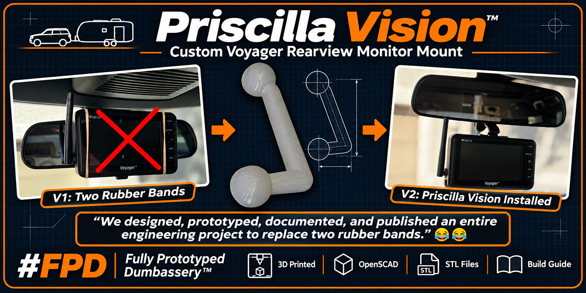
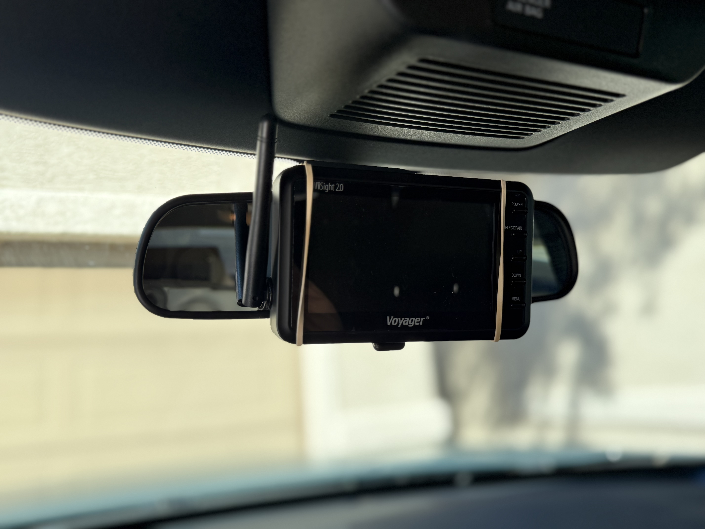
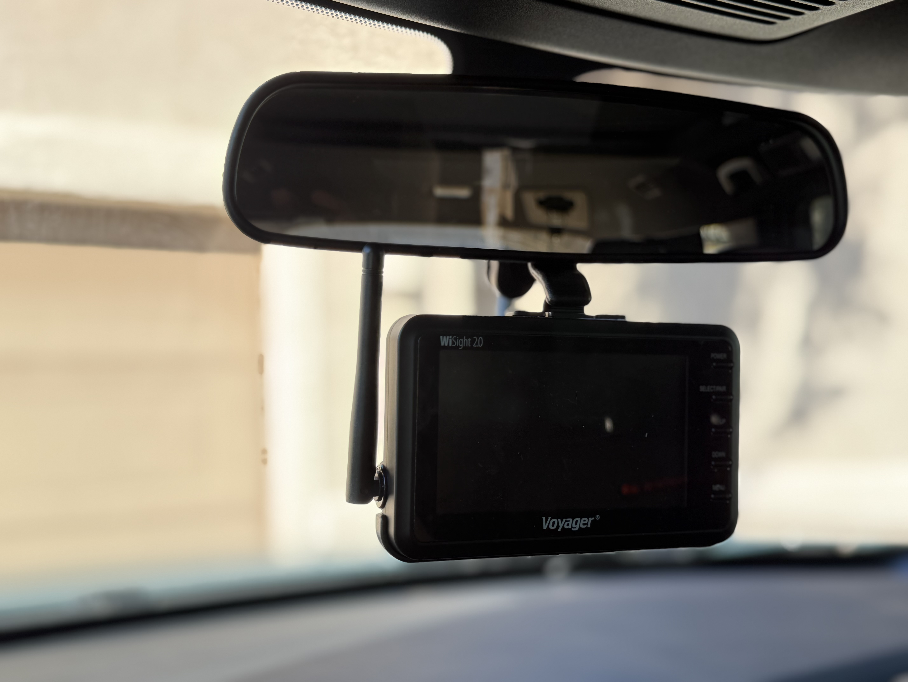
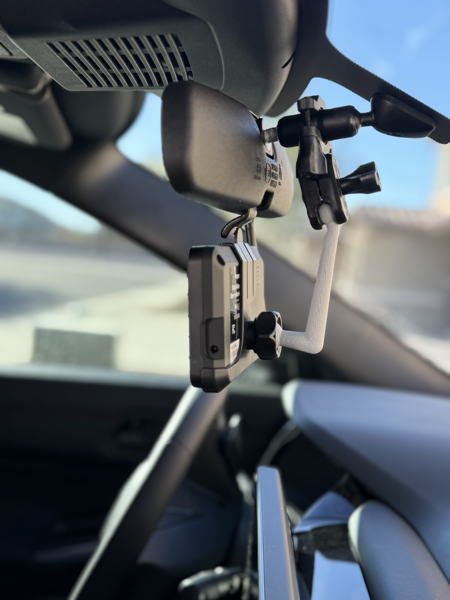
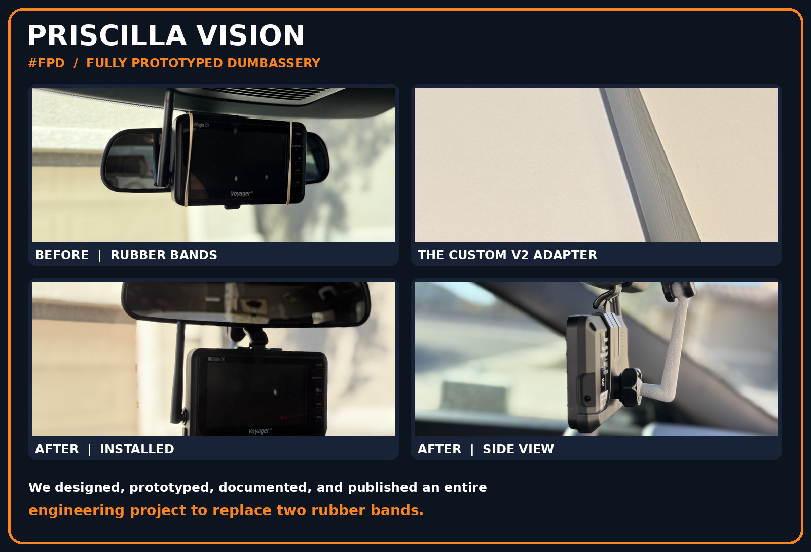

# Priscilla Vision™ — Custom Voyager Rearview Monitor Mount

> **We designed, prototyped, documented, and published an entire engineering project to replace two rubber bands.** 🤣🤣

**#FPD — Fully Prototyped Dumbassery™**

A removable, 3D-printed **double-ball adapter** that positions a **Voyager WiSight 2.0 WVSXM43 rear-observation monitor** below the factory rearview mirror in **Priscilla**, a 2026 Nissan Pathfinder Rock Creek, while towing **Trixie**, a 2027 Grand Design Transcend ONE 151BH.

The original arrangement held the monitor over the mirror with **two rubber bands**. It worked. Technically. The replacement uses a commercial mirror-neck clamp, its adjustable ball-socket arm, and a custom angled adapter with different-sized ball ends. No drilling or vehicle adhesives required.

## Before → After

| Before: two rubber bands | After: Priscilla Vision V2 |
|:--:|:--:|
|  |  |

## Start Here

- [Installation instructions](documentation/assembly-instructions/assembly-instructions.md)
- [Hardware and purchase list](buy-list/Priscilla-Vision-Buy-List.md)
- [Bambu Studio print notes](bambu-studio-3mf/print-notes.md)
- [V2 OpenSCAD source and STL](stl-scad/)
- [Bambu Studio V2 project](bambu-studio-3mf/Priscilla_Vision_V2.3mf)
- [Photo contact sheet](documentation/images/CONTACT-SHEET.md) · [Original product photos](documentation/product-images/)
- [Safety disclaimer](DISCLAIMER.md)

## The Adapter

| Parameter | V2 |
|---|---:|
| Commercial-arm ball diameter | **15.75 mm** |
| Voyager-monitor ball diameter | **20.75 mm** |
| Long span, nominal ball-center to elbow | **85 mm** |
| Short span, nominal ball-center to elbow | **30 mm** |
| Elbow included angle | **90°** |
| Main-arm lean | **12°** |
| Kit-end neck kink | **30°** |
| Long / short neck diameter | **8 / 9 mm** |
| Elbow reinforcement diameter | **13 mm** |

The ball diameters were tuned by physical fitting: initial 16 mm and 21 mm caliper measurements were each reduced **0.25 mm in diameter** for the V2 print. The 85 mm long span was a second fit iteration to achieve the intended clearance. The supplied SCAD is parametric; edit its values for a different socket or installation. These dimensions are **fit-specific, not universal automotive ball standards**.

## Parts

The printed part is a **single solid** with no heat-set inserts or additional adapter screws.

- [16-connector rearview mirror mounting kit (Amazon, ASIN B0DQW4Q5QD)](https://www.amazon.com/dp/B0DQW4Q5QD) — **$9.99** at the time of purchase; price may change
- **Priscilla Vision V2** printed double-ball adapter — PETG prototype shown
- Existing Voyager WiSight monitor, its socket/mount, and original threaded locking collar

See the [buy list](buy-list/Priscilla-Vision-Buy-List.md) for details. Compatibility with other mounts and ball sockets has not been verified.

## Installation Summary

1. Attach the commercial mirror clamp to the **rearview mirror neck/stub**, without interfering with mirror adjustment, vehicle sensors, or the driver's field of view.
2. Attach the **smaller 15.75 mm ball** of the printed adapter to the commercial arm's ball clamp/socket. Secure its adjustment knob.
3. **Slide the Voyager locking collar/nut over the larger ball's neck before connecting the monitor.** Seat the **20.75 mm ball** in the existing Voyager monitor socket and tighten the collar.
4. Adjust the viewing angle, tighten both joints, and check clearance and retention.

For normal driving between towing trips, the intended arrangement is to leave **only the commercial mirror-neck clamp** in place and stow the removable arm, adapter, and monitor together.

## Printing and Iteration

**Measure → model → print → fit → revise → test.**

V1 established the elbow/offset geometry. V2 reduced each ball diameter by 0.25 mm and lengthened the long span by 25 mm. **V2 PETG fit and adjustment are confirmed on the actual vehicle**; the monitor was used on a short trip while towing the trailer to storage, with **minor road vibration observed**. This is an initial field test, not a durability or crash-safety certification.

The print was oriented **flat in the plane of the bent arm** to favor continuous filament paths across the elbow. The finished white PETG print shows obvious layer lines. Surface finish was not a project requirement. See [print notes](bambu-studio-3mf/print-notes.md).

**Material strategy:** prototype in PETG on home printers in an unventilated office; an eventual heat-resistant **ASA** version may be outsourced. Do not assume PETG will survive prolonged Arizona summer vehicle temperatures or repeated sustained loading. An ASA print may require separate fit tuning.

## Photos and Contact Sheet

The [contact-sheet index](documentation/images/CONTACT-SHEET.md) links to all original photographs in `documentation/product-images/`. The image above is generated from **actual repo photos**, not AI mockups. The published contact sheet is a static documentation image; the original photographs are retained in the repository.

## AI-Assisted Development

This project was designed and documented with AI assistance, translating caliper measurements and a hand-drawn geometry sketch into parametric OpenSCAD, then refining dimensions after real printed fit tests. The final decisions came from **the printed hardware, the actual monitor, and the Pathfinder**—not a CAD preview.

## Repository Organization

| Location | Contents |
|---|---|
| `stl-scad/` | Printable V2 STL and editable parametric OpenSCAD |
| `bambu-studio-3mf/` | V2 Bambu Studio project and print notes |
| `buy-list/` | Required commercial mounting kit and reused hardware |
| `documentation/assembly-instructions/` | Installation instructions and checks |
| `documentation/product-images/` | Actual before, after and side-view photos |
| `documentation/images/` | Contact-sheet index and generated contact sheet |

## Safety and Compatibility

This is a DIY vehicle-mounted accessory, **not an automotive-certified or crash-tested device**. A falling monitor or obstructed mirror can be hazardous. Check both ball-joint clamps, mirror attachment, mirror adjustment, visibility, nearby sensors, and any airbag deployment paths. Do not operate the monitor while driving. Inspect periodically for looseness, creep, cracks, or vibration; remove the installation if it becomes unsafe.

Read [DISCLAIMER.md](DISCLAIMER.md). Voyager, WiSight, Nissan, Pathfinder, Grand Design and other brands are referenced for compatibility only; this is an independent project without their endorsement.

## License

[Creative Commons Attribution-NonCommercial 4.0 International (CC BY-NC 4.0)](LICENSE).

---

**Questionably Built. Ridiculously Documented. Surprisingly Functional.**

**#FPD — Fully Prototyped Dumbassery™** · [Arroyo Cooperative](https://arroyoc.com)
