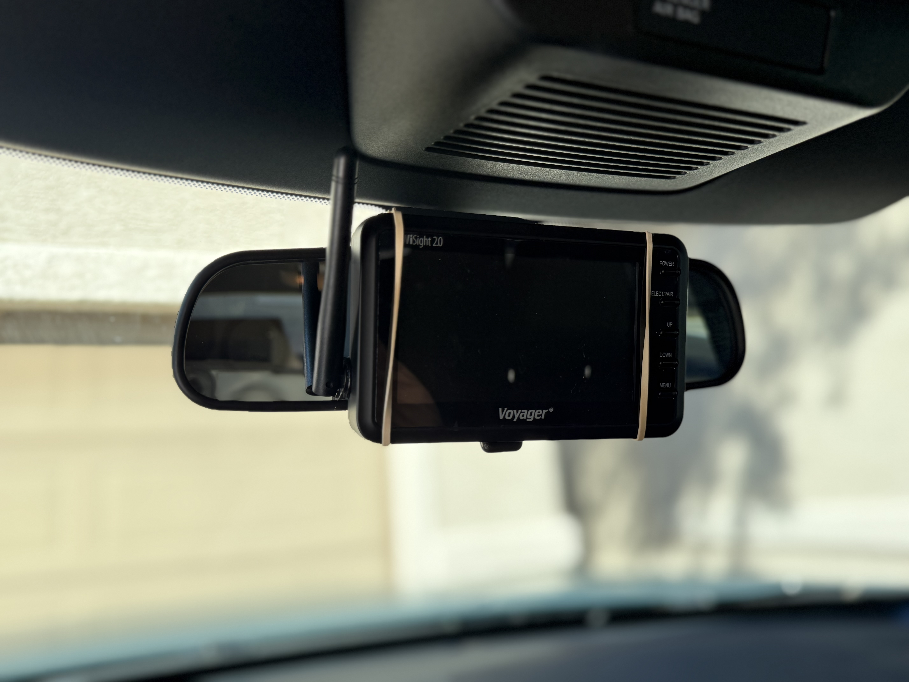
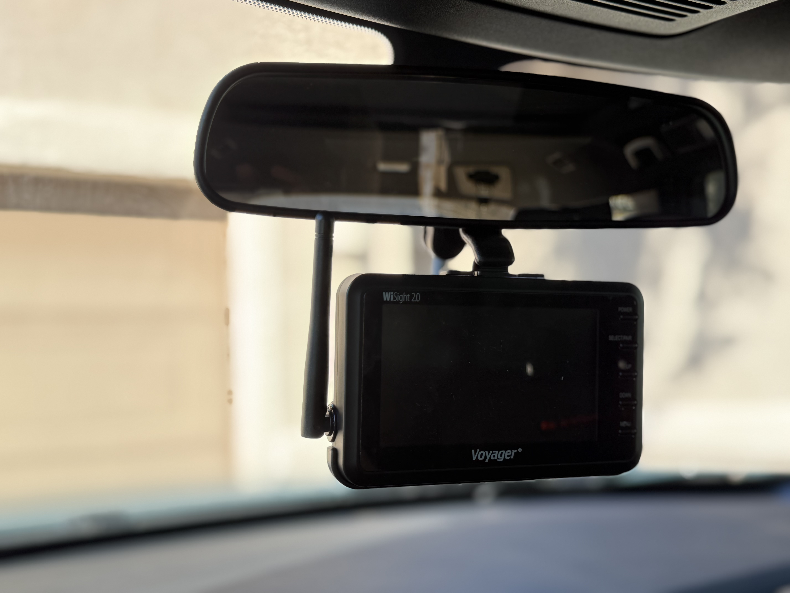
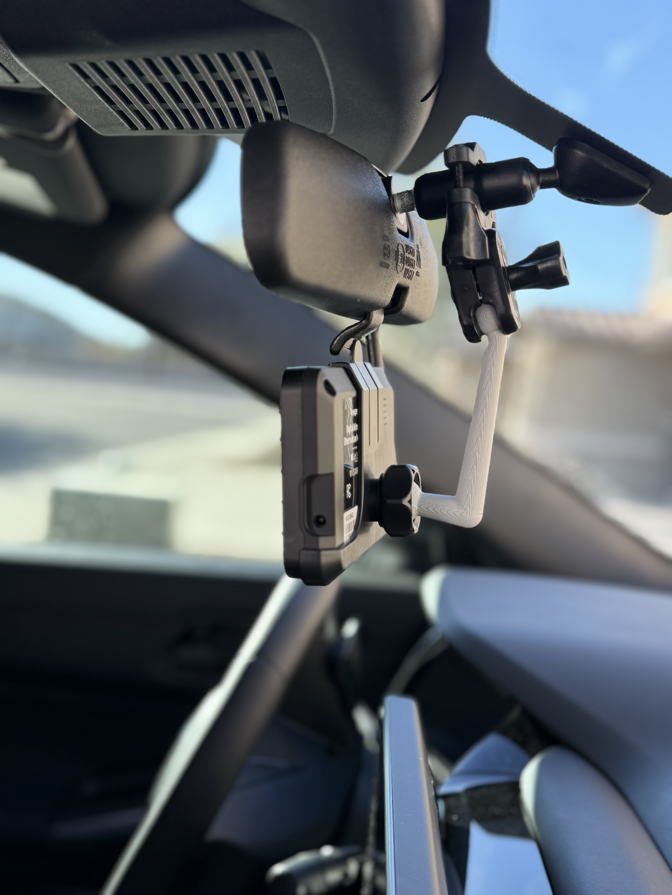

# Priscilla Vision — Installation Instructions

## What You Need

- Commercial **16-connector rearview mirror mounting kit**, [Amazon ASIN B0DQW4Q5QD](https://www.amazon.com/dp/B0DQW4Q5QD)
- Printed **Priscilla Vision V2 double-ball adapter**
- Existing **Voyager WiSight 2.0 monitor** and its ball socket/holder and threaded locking collar

No screws, inserts or adhesives are required for the printed adapter itself.

## Installation

1. With the vehicle parked, fit the **commercial clamp to the factory mirror neck/stub**. Do not clamp over a sensor housing, vehicle camera, wiring or an adjustment mechanism. Confirm the factory mirror retains its expected adjustment and stability.
2. Fit the kit's articulated ball-clamp arm to the commercial mirror clamp.
3. Place the **smaller 15.75 mm ball** of the printed adapter inside the arm's ball clamp/socket. Depending on the commercial joint's retaining opening, assembly may require temporarily separating the clamp halves; **do not force the ball past a retaining lip**. Tighten the joint's knob until it holds position without crushing the printed ball.
4. **Before seating the larger ball, slide the Voyager's original threaded lock collar onto the adapter neck**, in the correct orientation. This is easy to overlook.
5. Fit the **larger 20.75 mm ball** into the original Voyager monitor socket, then tighten the original lock collar. Confirm positive retention and usable angle adjustment.
6. Set the monitor slightly below the factory mirror, in a comfortable sightline, while preserving the mirror and normal forward visibility.
7. Confirm both joints are tight, the clamp is secure and the monitor cannot strike trim, wiring, glass or the factory mirror during adjustment.
8. With the vehicle stationary, gently test for unexpected movement. Recheck after a short controlled drive; stop use if the monitor slips, shakes excessively, obstructs visibility or interferes with any vehicle component.

## Between Towing Trips

The planned setup leaves only the **commercial mirror-neck clamp** in place. Remove the adjustable arm, **printed double-ball adapter**, and **Voyager monitor** together and stow them safely in the center console. Avoid repeatedly prying the ball joints apart unnecessarily.

## Initial Validation

V2 PETG held angle and tension during a real-world trip towing Trixie to storage. Some road vibration occurred due to the arm length, joint compliance and monitor mass. **Further vibration, thermal and long-term durability checks are still required**; this is not a certified restraint or safety system.

## Photo Reference

See [DISCLAIMER.md](../../DISCLAIMER.md) before use.
