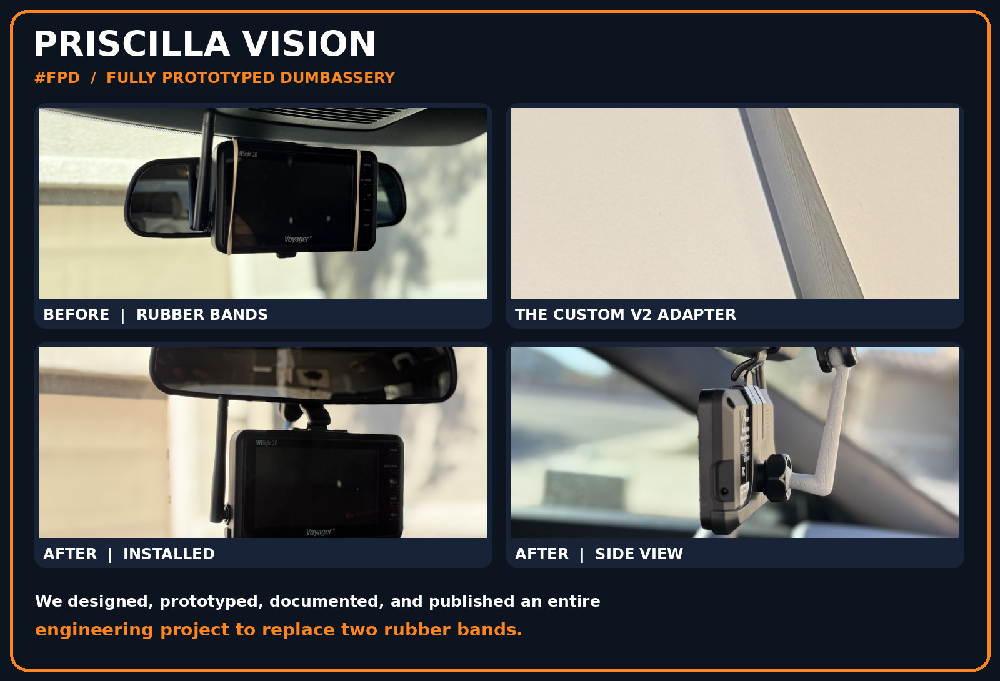
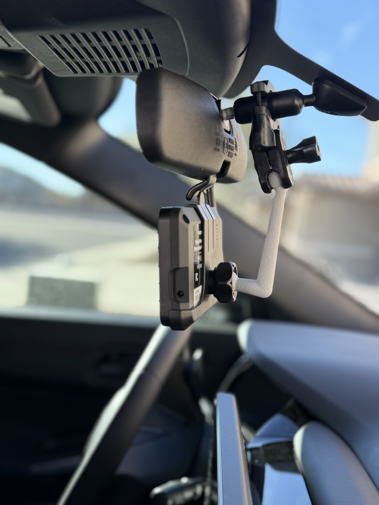

# Priscilla Vision — Photo Contact Sheet

The contact sheet is built from the **actual files in `documentation/product-images/`**. Original image files remain unchanged.

| Before | After / front | After / side |
|:--:|:--:|:--:|
|  |  |  |
| [ghetto_mount.jpg](../product-images/ghetto_mount.jpg) | [priscilla_vision_1.jpg](../product-images/priscilla_vision_1.jpg) | [priscilla_vision_2.jpg](../product-images/priscilla_vision_2.jpg) |

The contact sheet is retained as a static image for the published project documentation.
