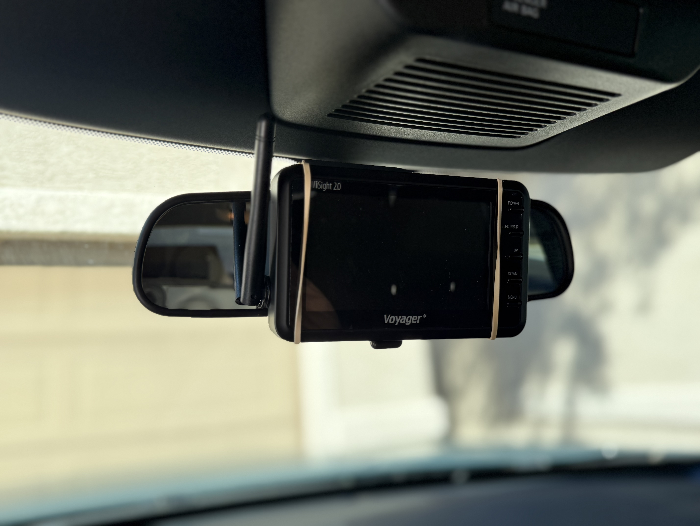
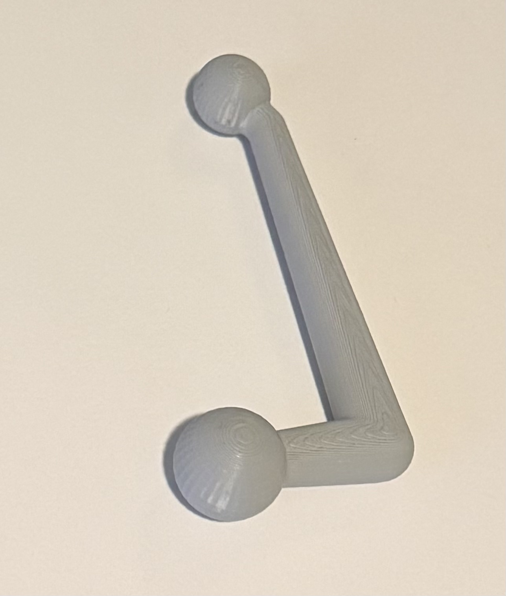
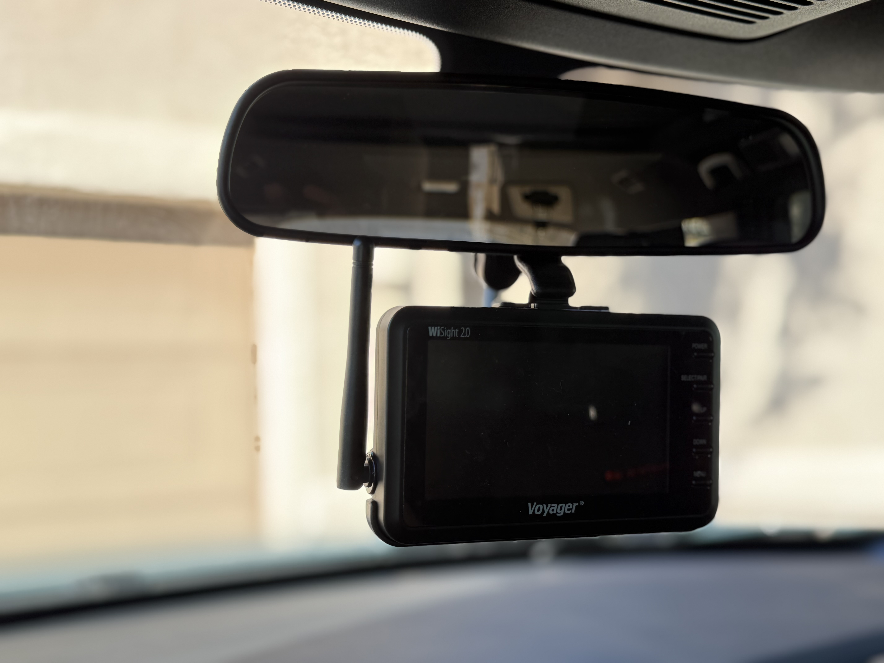

# Priscilla Vision — Photo Contact Sheet

The contact sheet uses **four actual project photographs** from `documentation/product-images/` — not generated mockups. The original image files remain unchanged.

| Before: rubber bands | Printed V2 adapter | After: installed | After: side view |
|:--:|:--:|:--:|:--:|
|  |  |  |  |
| [ghetto_mount.jpg](../product-images/ghetto_mount.jpg) | [adaptor.jpg](../product-images/adaptor.jpg) | [priscilla_vision_1.jpg](../product-images/priscilla_vision_1.jpg) | [priscilla_vision_2.jpg](../product-images/priscilla_vision_2.jpg) |

The contact sheet is a static publication asset. No scripts or GitHub Actions workflows are required in this repository.
